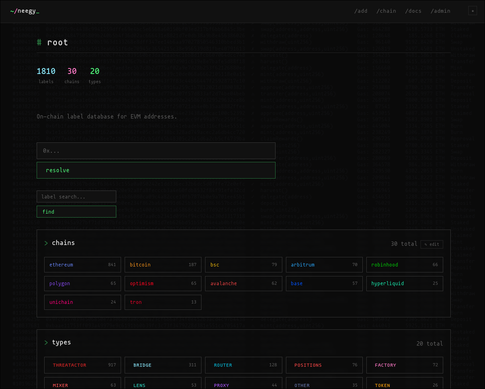

# NeegyLabels

Your very own self-hosted Wallet Labeling database with an API & webUI



## Features

- **REST API**: look up/add/delete labels and integrate directly into any tool.
- **Web UI**: browse and manage the database 
- **Multi-chain**: All major EVM chains & BTC (Solana planned)
- **Label types**: factory, wallet, dex, token, bridge, mixer, threatactor, and 15+ more
- **Confidence scores**: optional 0–100 rating per label
- **API key auth**: Bearer tokens generated via the admin panel

## Getting started

```bash
git clone https://github.com/contractaddress/NeegyLabels.git && cd NeegyLabels

# generate a session secret into .env
echo "API_KEY=$(openssl rand -hex 32)" > .env
```

Start the dev server
```
npm install
npx astro dev
```

Open `http://localhost:4321`.

On first visit you'll be prompted to create an admin account. The admin panel (`/admin`) is where you generate API tokens.

> **Note:** `API_KEY` is optional but recommended. If you skip it, the app auto-generates a random session secret (stored in `src/data/.session-secret`). Sessions stay secure, but you lose two conveniences: you can't use `API_KEY` directly as a Bearer token (use `/admin` tokens instead), and sessions reset whenever that file is deleted (e.g. a fresh deploy).

### API tokens

Two ways to authenticate against the API:

1. **`API_KEY` directly** — use the `.env` value as a Bearer token (handy for your own scripts). Only available when `API_KEY` is set.
2. **`n33gy...` tokens** — generated in the admin panel (`/admin`), stored as SHA-256 hashes. Use these for other tools/consumers, such as your agents, so you can revoke them individually.

> Note: currently querying with GET does not require a Bearer for convinience.

```bash
# Either works:
curl -H "Authorization: Bearer $API_KEY" http://localhost:4321/api/labels
curl -H "Authorization: Bearer n33gy<id>_<secret>" http://localhost:4321/api/labels
```

## API

See `/docs` in the web UI, or fetch the raw markdown:

```bash
curl http://localhost:4321/docs.txt
```

### Quick reference

| Method | Path | Auth | Description |
|--------|------|------|-------------|
| GET | `/api/labels` | — | List / search (`?address=`, `?chain=`, `?type=`, `?label=`, `?limit=`, `?offset=`) |
| POST | `/api/labels` | Bearer | Create a label |
| PUT | `/api/labels?address=&chain=` | Bearer | Update a label |
| DELETE | `/api/labels?address=&chain=` | Bearer | Delete a label |
| GET | `/api/types` | — | List all label types |

```bash
# List labels on a chain (auth required for mutations only)
curl -H "Authorization: Bearer n33gy<id>_<secret>" \
  http://localhost:4321/api/labels?chain=ethereum

# List all label types
curl http://localhost:4321/api/types
```

## License

MIT
